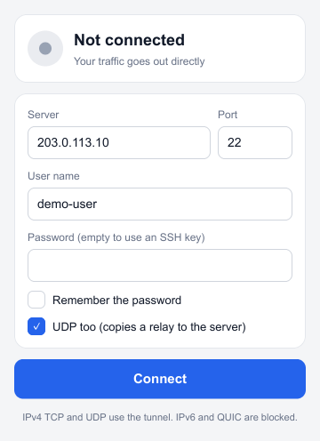
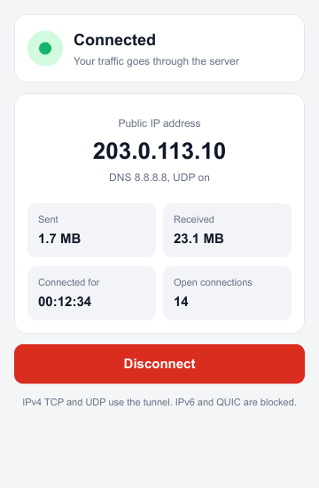
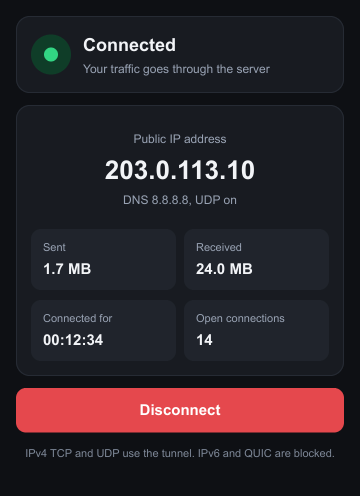

# Salam Tunnel

Route your whole computer through an SSH server with one button.

Salam Tunnel is written entirely in the
[Salam programming language](https://github.com/SalamLang/Salam). The window
uses Salam's page language and is drawn natively, with no browser engine, and it
follows the system light or dark appearance.

| Disconnected                                        | Connected                                     | Dark appearance                                    |
| --------------------------------------------------- | --------------------------------------------- | -------------------------------------------------- |
|  |  |  |

The screenshots show sample values.

## Features

- One **Connect** button for all IPv4 TCP traffic and DNS
- Optional **UDP** through a small relay on your server
- Uses the system OpenSSH client, with a password or an SSH key
- Reconnects by itself, and holds traffic back meanwhile instead of leaking it
- Several DNS servers to fall back on, switched while connected
- Passwords kept in the system's own secret store
- Restores your network on disconnect, and offers a repair button after a crash

## Platforms

| System  | State                                                                                                         |
| ------- | ------------------------------------------------------------------------------------------------------------- |
| Linux   | The whole tunnel is tested in arm64 containers, and the window on X11                                         |
| macOS   | Builds, signs in to a server and relays UDP; the privileged tunnel part has not been tested on a real Mac yet |
| Windows | Builds; it has not been run yet                                                                               |

## Requirements

- [Salam](https://github.com/SalamLang/Salam) 0.7.2 or newer
- An SSH account on a server that allows TCP forwarding
  (`AllowTcpForwarding yes`, the OpenSSH default)
- Administrator rights on your computer, asked on each connect
- **Linux:** a C compiler and `libx11-dev` to build; `iproute2`, `curl`, and
  polkit (`pkexec`) unless you start the app as root. Saving the password needs
  libsecret and a keyring such as GNOME Keyring or KWallet
- **Windows:** the OpenSSH client 8.4 or newer for password sign-in. Windows 10
  ships an older one, so install it from the
  [Win32-OpenSSH releases](https://github.com/PowerShell/Win32-OpenSSH/releases)
  or use an SSH key
- **UDP:** a Linux server on x86_64 or aarch64

## Build

```sh
git clone https://github.com/BaseMax/salam-ssh-tunnel.git
cd salam-ssh-tunnel
./build.sh
```

| Command                              | Result                            |
| ------------------------------------ | --------------------------------- |
| `./build.sh`                         | builds for the system you are on  |
| `./build.sh macos`                   | `~/Applications/Salam Tunnel.app` |
| `./build.sh linux /opt/salam-tunnel` | on Linux, into that folder        |
| `./build.sh windows`                 | a Windows build in `dist/windows` |

`SALAM=/path/to/salam` picks another compiler. The script also builds the two
Linux relay programs that the app copies to a server for UDP. A Windows build
downloads `wintun.dll` from [wintun.net](https://www.wintun.net), checks its
SHA-256 and puts it next to the app with its license.

## Use

1. Open the app.
2. Enter the server, port, username and password. Leave the password empty to use
   a key from `~/.ssh`; a key with a passphrase must be loaded in `ssh-agent`.
3. Tick **UDP too** if you want UDP, and **Remember the password** if you wish.
4. Press **Connect** and allow the administrator prompt.

When connected, the window shows your public IP address, which should be the
server's. Turn off other VPN apps before connecting.

## What goes through the tunnel

- All IPv4 TCP connections.
- DNS, sent as DNS over TCP. The app uses the first of these that answers through
  your server: the server's own resolver (`127.0.0.53`), Google (`8.8.8.8`,
  `8.8.4.4`), Cloudflare (`1.1.1.1`, `1.0.0.1`), Quad9 (`9.9.9.9`), `4.2.2.4` and
  OpenDNS (`208.67.222.222`). It checks the one in use every 20 seconds.
- UDP, if you tick **UDP too**. SSH cannot carry UDP, so the app copies a small
  relay program to `~/.salam-tunnel/` on the server and runs it over the SSH
  connection. It needs no root, listens only on the server's loopback address for
  a random token, and stops with the connection. The file stays there for next
  time. Only use this on a server where you may run programs. UDP port 443 (QUIC)
  stays blocked, so browsers use TCP, which is faster through SSH.
- **Not tunneled:** ICMP (`ping` fails), IPv6, fragmented packets, and all UDP
  when the box is not ticked. These are blocked, not leaked. Addresses on your
  local network stay local.

Sites see the server's country. Whatever is blocked there, or refuses visitors
from there, will not load while you are connected.

## How it works

```
your apps -> tunnel device -> helper -> SSH (SOCKS) -> server -> internet
                                     \-> UDP relay over the same SSH session
```

| File                           | Job                                                                      |
| ------------------------------ | ------------------------------------------------------------------------ |
| `main.salam`                   | the window and the program's modes                                       |
| `engine.salam`                 | runs `ssh`, starts the helper, watches and reconnects                    |
| `helper.salam`                 | runs as administrator: the tunnel device (`std/net/tun`), routes and DNS |
| `host.salam`                   | what differs between systems: paths, DNS settings and routes             |
| `resolver.salam`               | picks a DNS server that answers, and switches                            |
| `sshcmd.salam`, `remote.salam` | the SSH command line, and copying the relay                              |
| `profile.salam`                | saved settings and the password                                          |
| `relay/main.salam`             | the program that sends UDP from the server (`std/net/udprelay`)          |

The window and the helper are the same program. The system asks for permission
before the helper starts: a password prompt on macOS, polkit on Linux, UAC on
Windows. The helper restores the network when you disconnect, when the window
process dies, or when it receives a signal.

## If the network stays broken

Routes disappear when the helper exits. On macOS and Linux the DNS settings are
saved first, so after a crash or power loss open the app and press **Restore
network settings**. By hand:

```sh
sudo networksetup -setdnsservers Wi-Fi Empty                   # macOS
sudo cp /var/lib/salam-tunnel/dns.backup /etc/resolv.conf      # Linux
```

On Windows, remove a leftover rule in an administrator PowerShell:

```powershell
Get-DnsClientNrptRule | Where-Object Comment -like 'salam-tun-*' | Remove-DnsClientNrptRule -Force
```

The tunnel uses the addresses `172.19.0.0/30`; a local network in that range will
not work.

## Files and security

- `.salam-tunnel/` in your home folder holds the profile and the server's host
  key. The key is trusted on first use, and a changed key stops the connection.
- The password is stored only if you tick the box: in the macOS Keychain, the
  Linux keyring or the Windows Credential Manager. The box is hidden when there is
  no such store. The password reaches `ssh` through `SSH_ASKPASS` and never
  appears on a command line.
- The helper runs the app binary as administrator, so keep the app somewhere only
  you can write to.

## License

[GPL-3.0](LICENSE)
